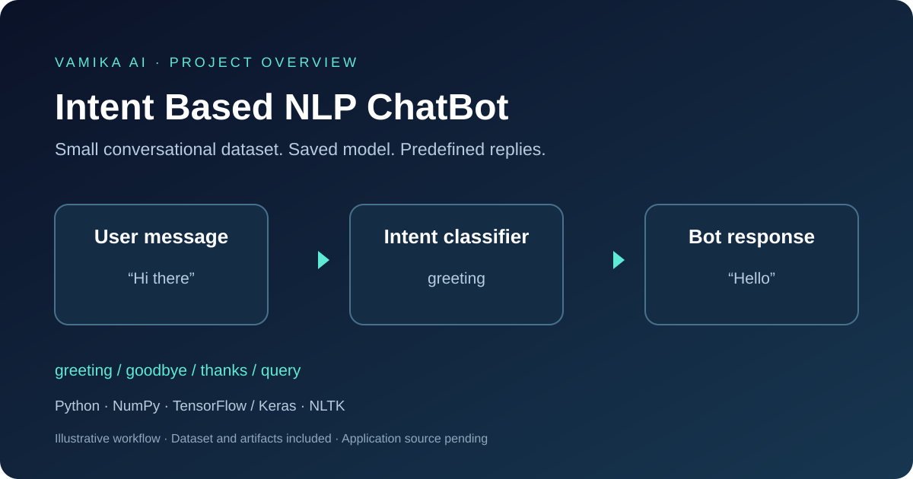

# DL - Intent Based NLP ChatBot

An intent-based natural language processing chatbot project featuring a small conversational intent dataset, a saved Keras model, and serialized vocabulary/class artifacts. The response data introduces the assistant as **Vamika AI**.



## Project summary

This repository preserves the data and trained-model artifacts for a chatbot that organizes conversational messages into predefined intents. Each intent pairs example user phrases with candidate replies. The included dataset covers greetings, goodbyes, thanks, and a short introduction to the assistant.

**Current status:** this is an artifact-and-dataset release. Training scripts, inference scripts, a user interface, evaluation results, and the original runtime version pins are not included. The overview image illustrates the intended workflow; it is not a screenshot of a running application.

## Included features

- A readable JSON intent dataset with example phrases and predefined responses.
- Four intent categories and 19 training phrases, including capitalization variants.
- A saved `.h5` model artifact for a Keras/TensorFlow workflow.
- Pickle artifacts named `words.pkl` and `classes.pkl` for vocabulary and label metadata.
- An extensible dataset structure for adding new conversational categories.

## Intent examples

| Intent | Example input | Example response |
| --- | --- | --- |
| `greeting` | `Hi there` | `Hello` |
| `goodbye` | `See you later` | `Have a nice day` |
| `thanks` | `Thank you` | `My pleasure` |
| `query` | `what you do?` | `Im Vamika AI, you're Virtual Chatbot. I help in answering your questions` |

These are dataset examples, not verified predictions from the saved model. Response selection behavior is not available in the supplied source.

## Repository structure

```text
DL-Intent-Based-NLP-ChatBot/
├── docs/
│   └── project-overview.svg  # Project workflow illustration
├── models/
│   └── chatbot_model.h5     # Saved model artifact
├── pickle/
│   ├── classes.pkl          # Serialized class artifact
│   └── words.pkl            # Serialized vocabulary artifact
├── .gitignore
├── intents.json             # Intent definitions and response templates
├── requirements.txt         # Original dependency list
└── README.md
```

Local virtual environments, editor settings, and conversation transcripts are excluded from version control.

## Technology

The original dependency list names Python libraries **NumPy**, **TensorFlow**, **Keras**, and **NLTK**. It also lists `json` and `random`, which are Python standard-library modules and do not need to be installed with pip. Library versions were not recorded, so compatibility with the saved model needs to be established before inference or retraining.

## Getting started

Clone the repository:

```bash
git clone https://github.com/vams2krish/DL-Intent-Based-NLP-ChatBot.git
cd DL-Intent-Based-NLP-ChatBot
```

You can inspect and validate the dataset with Python, without installing machine-learning packages:

```bash
python -m json.tool intents.json
```

For model exploration, create a separate environment:

```bash
python -m venv .venv
```

Activate it on Windows PowerShell:

```powershell
.\.venv\Scripts\Activate.ps1
```

Or on macOS/Linux:

```bash
source .venv/bin/activate
```

Install the third-party packages from the original dependency list explicitly:

```bash
python -m pip install numpy tensorflow keras nltk
```

This is a starting point for exploration, not a verified compatible runtime. Avoid installing `requirements.txt` verbatim because its original list includes standard-library modules. There is currently no `app.py`, training command, or chat command to run in this repository.

## Dataset format

`intents.json` contains a top-level `intents` array. Each entry has:

| Field | Meaning |
| --- | --- |
| `tag` | Name of the conversational intent |
| `patterns` | Example user messages associated with the intent |
| `responses` | Candidate replies for that intent |
| `context` | Context metadata; currently an array containing an empty string |

Example entry using the same schema:

```json
{
  "tag": "greeting",
  "patterns": ["Hi there", "Hello"],
  "responses": ["Hello", "Good to see you again"],
  "context": [""]
}
```

## Intended processing workflow

1. Receive a user message.
2. Apply the same tokenization, normalization, and feature construction used during training.
3. Use the saved model to classify the message into an intent.
4. Map the predicted class to an entry in `intents.json`.
5. Select a response, with a fallback for uncertain or unsupported messages.

The original preprocessing and inference implementations are missing. The precise feature encoding, confidence threshold, response-selection policy, and context behavior cannot be established from the dataset alone. Any replacement implementation should first verify alignment between the model, vocabulary, class ordering, and preprocessing.

## Model artifacts and limitations

- `models/chatbot_model.h5` is supplied as an existing artifact; its training provenance and compatibility have not been verified.
- The pickle files are supplied unchanged. Their names suggest their intended roles; their contents have not been deserialized for this release. Only load trusted pickle files, since deserialization can execute code.
- No accuracy, validation split, benchmark, or production-readiness claim is made.
- The dataset is small and includes only one `query` pattern. Broad question answering, robust multilingual support, and open-domain generation are not demonstrated.
- Model behavior may differ from the illustrative examples until the original runtime and preprocessing are recovered.

## Extending the project

Add intent categories and varied phrases to `intents.json`, then implement or restore training and inference scripts. Retrain whenever labels or vocabulary change, and export the model and metadata together. Useful next steps include a reproducible dependency lockfile, held-out evaluation data, a confidence-based fallback, and a command-line or web chat interface.

## Contributing

Issues and pull requests are welcome for dataset improvements, documentation corrections, reproducible model loading, and restored training/inference code. Include the environment and validation steps for changes affecting model behavior.

## License

No license has been selected for this repository. Public visibility alone does not grant an open-source license; reuse permissions should be clarified with the repository owner.
